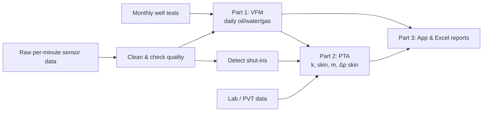

# The Beginner's Guide to Our Hackathon Project

**SOCAR Hackathon 2026: Intelligent Well Performance Analysis**

This guide explains the challenge, the petroleum theory behind it, what we built, why we built it this way, and what is still
missing. It assumes **no background in geology or petroleum engineering**. If you can read a graph and know what an average
is, you can follow it.

> **How to read this.** Sections 1–3 give you the background (the task, the rocks, the well). Sections 4–6 explain our two
> analysis modules (rates and reservoir properties). Sections 7–9 cover the app, the honest list of gaps, and a cheat-sheet.
> Every number quoted here comes from our current pipeline run.

---

## Contents

1. [The challenge in one page](#1-the-challenge-in-one-page)
2. [Petroleum geology from zero](#2-petroleum-geology-from-zero)
3. [The well and its sensors](#3-the-well-and-its-sensors)
4. [The data we received (and what was wrong with it)](#4-the-data-we-received-and-what-was-wrong-with-it)
5. [Part 1: Virtual Flow Metering (VFM)](#5-part-1--virtual-flow-metering-vfm)
6. [Part 2: Pressure Transient Analysis (PTA)](#6-part-2--pressure-transient-analysis-pta)
7. [Part 3: The application](#7-part-3--the-application)
8. [Gaps, limitations and what could be better](#8-gaps-limitations-and-what-could-be-better)
9. [Cheat-sheet: glossary, units, formulas, code map](#9-cheat-sheet)

---

## 1. The challenge in one page

### The problem in plain words

An oil company needs to know, every day, **how much oil, water and gas each well produces**. It also wants to know **what the
rock around each well is like**: how easily oil flows through it, and whether the area right around the well is clogged.

Measuring this directly is hard:

- **Rates.** A well's production is properly measured only during a *well test*, when its flow is routed through a special
  measuring vessel (a *test separator*) for half a day or so. That happens roughly **once a month per well**. For the other ~29 days, nobody knows the rates exactly.
- **Rock properties.** The rock is 2–3 km underground. We can't go and look. We have to infer its properties from how
  pressure behaves.

What every well *does* have is **cheap sensors that record every minute**: pressures, temperatures, how much gas is being
injected, and how far a valve (the choke) is open. The challenge is to turn those sensor streams into the numbers engineers need.

### The three parts

| Part | Name | In plain words | Output |
|---|---|---|---|
| **1** | **Virtual Flow Metering (VFM)** | Use the monthly well tests to teach a model how sensor readings relate to production, then estimate production **every day** from the sensors alone. A "virtual meter" made of software. | Daily oil, water and gas rate per well |
| **2** | **Pressure Transient Analysis (PTA)** | When a well is shut in, pressure at the bottom of the well climbs back up. The **shape of that recovery curve** reveals the rock's properties. Use the Part 1 oil rate plus lab data to read them off. | Permeability *k*, skin *s*, Horner slope *m*, pressure drop due to skin Δp<sub>skin</sub> per shut-in |
| **3** | **Interactive application** | One tool where an engineer loads data, runs both analyses, and reads the answers. | A working UI with plots and exports |

### How it is scored (100 points)

| Area | Points | Breakdown |
|---|---|---|
| VFM | **50** | methodology 20, prediction accuracy 30 |
| PTA | **30** | required plots 10, parameter results 20 |
| UI | 10 | functionality and usability 4, workflow 6 |
| Presentation | 10 | — |

Half the points are VFM, so that is where we put the most rigour.

### Required deliverables

1. An Excel file of daily predictions: `date, well_name, oil_rate_stbd, water_rate_stbd, gas_rate_mscfd`.
2. An Excel file with one row per shut-in event: Horner slope, skin, permeability (md), Δp skin (psi).
3. PTA plots for every shut-in, accessible in the UI.
4. A working UI that produces all of the above.

All four exist (`artifacts/` folder and the Streamlit app).

### The workflow at a glance



---

## 2. Petroleum geology from zero

### Oil lives *inside* rock, not in caves

A common picture is an underground lake of oil. That's wrong. Oil sits in the **tiny pores of a rock**, usually sandstone,
the way water sits in a kitchen sponge. Pores are often less than a millimetre across.

Two properties of that sponge matter most:

| Property | Symbol | Meaning | Sponge analogy | Our wells |
|---|---|---|---|---|
| **Porosity** | φ (phi) | Fraction of the rock volume that is empty pore space | How many holes the sponge has | 0.16–0.26 (16–26%) |
| **Permeability** | *k* | How easily fluid flows through the connected pores. Unit: **millidarcy (md)** | How easily you can blow air through the sponge | ~40–300 md (from our PTA) |

A rock can have lots of pores (high porosity) that are poorly connected (low permeability), like a sponge full of sealed
bubbles. **Permeability is what controls production rate**, and Part 2 estimates it.

Rule of thumb for *k*: under 1 md is "tight", 10–100 md is good, over 100 md is very good.

### More rock and fluid properties (from `reservoir_pvt.csv`)

"PVT" means **Pressure–Volume–Temperature**: lab measurements of how the fluids behave.

| Property | Symbol / column | Meaning in plain words |
|---|---|---|
| **Net pay thickness** | *h*, `net_pay_thickness_ft` | Thickness of the oil-bearing rock layer that actually produces (32–136 ft here) |
| **Water saturation** | S<sub>w</sub> | Fraction of the pore space filled with water rather than oil. Rock pores always hold some water. |
| **Oil viscosity** | μ (mu), `oil_viscosity_cp` | How "thick" the oil is. Honey is high, water is ~1 cp. Ours: 0.9–3 cp, fairly light oil. |
| **Formation volume factor** | B<sub>o</sub>, `oil_fvf_rb_stb` | Oil underground holds dissolved gas and takes up more space. When it reaches the surface the gas bubbles out and the oil **shrinks**. B<sub>o</sub> = 1.15 means 1.15 barrels underground become 1 barrel at the surface. |
| **Total compressibility** | c<sub>t</sub> | How much the rock and fluids squeeze per psi of pressure. Controls **how fast pressure changes travel** through the rock. |
| **Bubble-point pressure** | p<sub>b</sub> | Above this pressure all gas stays dissolved in the oil (like a sealed soda bottle). Below it, gas bubbles form in the rock. Ours: ~1,200–1,600 psia. |
| **Solution GOR** | R<sub>s</sub> | How much gas is dissolved in each barrel of oil (scf/STB). This gas comes out at the surface. |
| **Wellbore radius** | r<sub>w</sub> | Radius of the drilled hole (~0.3 ft). |
| **Drainage area** | A | The patch of reservoir each well drains (100–620 acres). |

### The single most important physics fact for this project

All our wells flow with bottom-hole pressure (**2,300–3,700 psia**) **far above** the bubble point (**~1,200–1,600 psia**).
The oil is *undersaturated*: the soda bottle is still sealed when the oil reaches the well. Three things follow, and our whole
model is built on them:

1. Only liquid (oil + water) flows in the rock, so the flow equations stay **simple and linear**.
2. The gas we produce is just the dissolved gas coming out at the surface. **Gas-to-oil ratio (GOR) ≈ R<sub>s</sub>**, a constant.
   The tests confirm this within ~3% for every well (e.g. GL-02: measured 302, R<sub>s</sub> 301 scf/STB).
3. Single-phase flow is exactly what textbook PTA assumes, so the challenge's "treat the reservoir as single-phase oil"
   instruction is physically justified here.

### Reservoir pressure and why rates decline

The fluid in the rock is under high pressure, the **reservoir pressure** p̄ (p-bar). A well works by creating a
**lower** pressure at the bottom of the hole, p<sub>wf</sub> ("flowing bottom-hole pressure"). Fluid flows from high to low
pressure, like water down a slope.

The difference p̄ − p<sub>wf</sub> is called the **drawdown**. Bigger drawdown means more flow.

As oil is removed, reservoir pressure slowly falls, unless water injection or a natural aquifer pushes it back up. Water
also tends to creep towards the wells over time, so the **water cut** (fraction of liquid that is water) rises. Both effects
are visible in our data. Water cut rises steadily in every well, for example GL-01 from 42% to 47% over nine months.

### Units you will see everywhere (American oilfield units)

| Unit | Meaning |
|---|---|
| **STB/d** | Stock-tank barrels per day: barrels measured at surface conditions. 1 barrel ≈ 159 litres. |
| **Mscf/d** | Thousand standard cubic feet of gas per day. 1 Mscf ≈ 28.3 m³. |
| **psia** | Pounds per square inch, absolute. 14.7 psia = 1 atmosphere. 3,000 psia ≈ 207 bar. |
| **°F** | Degrees Fahrenheit. 200 °F ≈ 93 °C. |
| **ft, TVD** | Feet, true vertical depth (straight down, even if the well is slanted). |
| **md** | Millidarcy: permeability. |
| **cp** | Centipoise: viscosity. |

---

## 3. The well and its sensors

```
   Separator ◄── flowline ◄── [CHOKE] ◄── WELLHEAD  ── whp_psia (upstream), whp_downstream_psia
                                │            │
              gas-lift gas ────►│ annulus    │ tubing        annulus_pressure_psia
              (gas_lift_rate)   │ (outer)    │ (inner)       gas_lift_rate_mscfd
                                │            │
                                │   ◄──GL valve (gas enters tubing here, ~2,700–5,800 ft)
                                │            │
                                │            │
                                │     [GAUGE] dh_pressure_psia, dh_temperature_degf  (~7,500–9,900 ft)
                                │            │
   ~~~~~~ reservoir rock ~~~~~~~~~ perforations ~~~~~~ oil + water flow in ~~~~~~
```

| Part | What it is | Sensor columns |
|---|---|---|
| **Tubing** | The pipe the oil travels up | — |
| **Downhole gauge** | Pressure and temperature sensor near the bottom of the well. **Our most valuable sensor.** | `dh_pressure_psia`, `dh_temperature_degf` |
| **Wellhead** | The valves at the top of the well | `whp_psia` (pressure before the choke) |
| **Choke** | An adjustable restriction (a valve) controlling how fast the well flows. Opened in % of max size. | `choke_opening_pct` (from `choke_events.csv`), `whp_downstream_psia` (pressure after the choke) |
| **Annulus** | The ring-shaped gap between the tubing and the outer casing | `annulus_pressure_psia` |
| **Gas lift** | Gas is pumped down the annulus and enters the tubing through a valve. It makes the fluid column lighter and easier to lift, which lowers p<sub>wf</sub> and increases flow, like blowing bubbles into a straw. | `gas_lift_rate_mscfd` |

**Why the downhole pressure is the key signal.** Choke changes, gas-lift changes and tubing friction all affect production
**only by changing the pressure at the bottom of the well**. The reservoir doesn't "know" about the choke. It only feels
p<sub>wf</sub>. So if you know p<sub>wf</sub> and the reservoir's state, you know the inflow. We measure p<sub>wf</sub> every minute.

**Two kinds of "well test"** (easy to confuse):

1. **Production test**: flow the well through a test separator for 12–24 h and measure oil, water and gas rates.
   These are our VFM labels (`well_tests.csv`).
2. **Pressure transient test (build-up)**: shut the well in and record the pressure recovering. That's what Part 2
   interprets. In our data the shut-ins appear inside the per-minute sensor stream.

---

## 4. The data we received (and what was wrong with it)

| File | Rows | What it contains |
|---|---|---|
| `high_freq_data.csv` | 3.9 million | One reading per minute, 10 wells (GL-01 … GL-10), 1 Jan–30 Sep 2025: wellhead pressures, downhole pressure and temperature, annulus pressure, gas-lift rate |
| `well_tests.csv` | 85 | ~monthly production tests: measured oil, water and gas rates plus sensor averages during each test. **Our training labels.** |
| `choke_events.csv` | 66 | Each time a choke setting changed. 0% = closed (well shut in). |
| `reservoir_pvt.csv` | 10 | Rock and fluid properties per well (Section 2) |
| `well_completion.csv` | 10 | Gauge depth, gas-lift valve depth, tubing size, solution GOR, cumulative oil produced before 1 Jan 2025 |
| `pta_results.csv` | 17 | Reference PTA answers. **Deliberately not used** (team decision): our PTA must stand on its own. |

The data looks like it was generated with physical models (wells named GL-xx, very clean physics), with errors planted
on purpose to test whether teams check data quality.

### Problems we found and fixed

**Per-minute sensor data:**

| Problem | How many | Fix |
|---|---|---|
| `-999.25` values (a standard "no reading" code in oil-industry log files) | ~1,300 per column | Set to missing |
| Spikes (e.g. wellhead pressure jumping to 1,219 psia for one minute) | ~450 total | **Hampel filter**: compare each point with the median of its 31-minute neighbourhood and remove it if it's wildly off |
| Duplicate timestamps | 2,513 | Averaged |
| Gaps (minutes with no data at all) | up to 36 h | Short gaps (≤ 10 min) interpolated; long gaps left empty and flagged |
| Frozen sensors (same value repeated for an hour or more) | checked | Removed |

**Well tests.** We fixed these using *redundancy*: the file stores related numbers that must agree (liquid = oil + water,
total gas = formation gas + lift gas, water cut = water ÷ liquid). When one disagrees, the others reveal the right value.

| Problem | Example | Fix |
|---|---|---|
| Sign flips | lift gas `-717.5` (GL-06), water `-572.2` | Absolute value (5 cases) |
| **Wrong units** | GL-06 gas reported as 5,493 when oil × GOR says 194 | 194 Mscf/d ÷ 28.3 m³/Mscf ≈ 5,494. **All 9 GL-06 tests were in m³/d**, so they were converted. |

Every correction is logged and shown in the app (*Data & quality* tab), so nothing is changed silently.

### An important detail: which gas do we predict?

Gas-lifted wells produce two kinds of gas at the surface: **formation gas** (came out of the oil) and **lift gas** (we pumped it in
and it comes back out). In the test file, `gas_rate_mscfd` = oil × GOR (formation gas only) and `total_gas_rate_mscfd` = formation +
lift gas. The deliverable column is `gas_rate_mscfd`, so we **predict formation gas**.

---

## 5. Part 1: Virtual Flow Metering (VFM)

### 5.1 The idea

Tests give the true rates on ~9 days per well. Sensors give the conditions on all 273 days. VFM fills the gaps:
**learn the link from the test days, apply it every day.**

### 5.2 The theory: how fluid flows into a well

The flow of fluid through porous rock follows **Darcy's law** (1856): flow rate is proportional to permeability, area and pressure
difference, and inversely proportional to viscosity. For a well draining a circular area, after the initial transients have died
down, it becomes:

$$
q = \underbrace{\frac{k\,h}{141.2\,B\,\mu\,\left[\ln(r_e/r_w) - 0.75 + s\right]}}_{J\ \text{(productivity index)}}\;\left(\bar p - p_{wf}\right)
$$

In words: **rate = J × drawdown.** J, the *productivity index*, bundles all the rock properties into one number: barrels per day
gained per psi of drawdown. Above the bubble point, J is constant, so this is a **straight line** called the *Inflow
Performance Relationship (IPR)*. (Below the bubble point the line bends; Vogel's curve handles that, but we don't need it.)

### 5.3 Our model

For each well:

| Quantity | Formula | Why |
|---|---|---|
| **Liquid rate** | q<sub>L</sub> = J · (p̄(t) − p<sub>wf</sub>), with p̄(t) = p<sub>0</sub> + p<sub>1</sub>·t | The IPR above. Reservoir pressure p̄ isn't measured daily, so we let it **drift linearly in time** and learn the drift from the tests. p<sub>wf</sub> = daily median of the downhole gauge. |
| **Water cut** | WC(t) = c + d·t | Water cut rises steadily. Its within-well correlation with time is 0.89. |
| **GOR** | test average, nudged toward R<sub>s</sub> | Undersaturated oil gives constant GOR = R<sub>s</sub> (Section 2). Blending with the lab value reduces noise. |
| **Phases** | oil = q<sub>L</sub>(1 − WC), water = q<sub>L</sub>·WC, gas = oil × GOR / 1000 | Bookkeeping |
| **Daily volume** | rate × fraction of the day the well was flowing | A well shut in for 6 hours produces 18/24 of a normal day |

Rearranged, the liquid equation is **q<sub>L</sub> = a + b·t − J·p<sub>wf</sub>**: a linear regression with three numbers per well,
fitted to that well's ~9 tests.

**Worked example (GL-04, April test).** A choke cut pushed p<sub>wf</sub> up by ~125 psi above normal. With J ≈ 1.18 STB/d/psi
the model expects liquid to drop by ~150 STB/d. The test measured 995 STB/d against ~1,180 in neighbouring months. The physics explains
day-to-day swings that a pure time trend would miss.

**A safety net for J.** In some wells p<sub>wf</sub> barely changed between tests (GL-10's seven tests span only 13 psi). Then the data can't
tell how sensitive the rate is to pressure, and a free regression produced nonsense (J ≈ 0.1, implying a reservoir pressure of
27,000 psi). We use **ridge regularisation**: J is pulled toward a typical value learned from all wells, and the pull weakens as the
well's own data gets more informative. Accuracy is unchanged where it matters, and every well's implied reservoir pressure is now
physically sensible.

### 5.4 Why this method and not machine learning?

We tested several candidates honestly (Section 5.5 explains the testing):

| Candidate | Oil error (MAPE) | Verdict |
|---|---|---|
| Carry the last test forward (what engineers do today: **baseline**) | 6.0% | Baseline to beat |
| Per-well straight-line time trend | 6.0% | Misses pressure-driven swings |
| **LightGBM** (gradient-boosted trees, 10 sensor features) | 5.1% | Better than baseline, worse than physics |
| **Physics IPR model (ours)** | **3.5%** | **Best** |

Why physics wins here:

- **Tiny training set.** 85 tests (~9 per well). Flexible ML models need hundreds or thousands of examples to learn what physics
  gives for free.
- **Trees can't extrapolate.** A decision-tree model can only predict values similar to what it has seen. Reservoir pressure
  keeps declining into territory the training data never covered.
- **Explainability.** Every parameter means something: J is productivity, the time trend is depletion, the WC slope is water
  breakthrough. An engineer can check each one, which ML features don't allow.
- **The model still learns from data.** It is a statistical model fitted to measurements, with a physical structure. That is
  sometimes called *physics-informed* or *grey-box* modelling.

### 5.5 How we know it works: validation

The golden rule: **never grade a model on data it was trained on.** We use two schemes:

1. **Forward-chaining** (the realistic one). To predict the July test we train only on tests before July, then move forward one
   test at a time. This mimics real use, where you only know the past.
2. **Leave-one-test-out.** Hide one test, train on all the others, predict the hidden one, repeat for all 85. This mimics filling
   in days *between* tests, which is exactly what the daily Excel deliverable does.

The metric is **MAPE** (mean absolute percentage error): on average, how many % the prediction is off.

| Out-of-sample error | Oil | Water | Gas |
|---|---|---|---|
| Baseline (last test carried forward) | 6.0% | 5.9% | 9.2% |
| **VFM, forward-chaining** | **3.5%** | **4.8%** | **5.9%** |
| **VFM, leave-one-test-out** | **2.5%** | **3.6%** | **5.6%** |

We also check **bias** (systematic over- or under-prediction). It stays within ±1.2% for every phase, so errors are random, not
systematic.

**Why gas is the weakest.** Measured GOR jumps around by ~6% from test to test, and we checked it against every sensor: nothing
predicts it (all |correlations| ≤ 0.24). It is most likely measurement noise in the test itself. No model can predict noise, so
~5–6% is near the floor for gas.

### 5.6 Uncertainty bands

Every daily prediction has a **90% prediction band**, taken from the actual out-of-sample errors: the 5th and 95th percentiles of
(measured − predicted)/predicted across the 55 forward-chaining tests. The band is roughly −6%/+9% for oil, −8%/+12% for water and
±15% for gas. These come from measured errors, not made-up confidence values.

---

## 6. Part 2: Pressure Transient Analysis (PTA)

### 6.1 The idea in one picture

Close the valve on a flowing well and the pressure at the bottom climbs back up: quickly at first, then slower and slower.
Think of a crowd leaving a stadium through one gate. Close the gate and people stop moving away from it. **How fast the
crowd closes the gap tells you how freely people can move.**

```
pressure
   ▲                       ___________________  ← approaches reservoir pressure
   │                 _____/
   │            ___/
   │         _/
   │       /        ← fast rise: fluid rushing back toward the well
   │      |
   │______|  ← flowing pressure p_wf just before shut-in
   └──────┴──────────────────────────────────► time
       shut-in
```

### 6.2 The theory

**Pressure diffuses.** A pressure change spreads through rock the way heat spreads through metal. The diffusion speed is set by
η = k/(φ μ c<sub>t</sub>): high permeability spreads it fast.

**Radial flow gives a straight line on a log scale.** While the pressure disturbance spreads outward in an ever-growing circle
(*infinite-acting radial flow*, IARF), the theory says pressure rises in proportion to the **logarithm** of time. So on a plot of
pressure against log(time) you get a **straight line**, and its slope is:

$$
m = \frac{162.6\, q\, B\, \mu}{k\, h} \quad\text{(psi per log cycle)} \qquad\Longrightarrow\qquad k = \frac{162.6\,q\,B\,\mu}{m\,h}
$$

A gentle slope means pressure recovers easily, so permeability is high. **This is why Part 2 needs Part 1:** *k* is proportional to
the oil rate q, and q comes from our VFM.

**Horner's method (1951).** A build-up comes after a long period of production, and the well "remembers" it. Horner used
*superposition*: shutting in is mathematically equivalent to adding an injector with the same rate on top of the producer at the
moment of shut-in. The result is:

$$
p_{ws} = p^* - m\,\log_{10}\!\left(\frac{t_p + \Delta t}{\Delta t}\right)
$$

- Δt = time since shut-in. The ratio (t<sub>p</sub> + Δt)/Δt is the **Horner time**, which starts huge and falls towards 1.
- t<sub>p</sub> = how long the well produced. Since rates vary, we use Horner's **pseudo-producing time** t<sub>p</sub> = 24·N<sub>p</sub>/q
  (cumulative oil ÷ last rate, in hours). N<sub>p</sub> = cumulative oil before 2025 (completion file) + our VFM daily volumes since.
- **p\*** = where the straight line hits Horner time = 1 (infinite shut-in time). It is an estimate of the reservoir pressure.

#### Two clocks: t<sub>p</sub> and Δt

A build-up analysis uses two different times, and mixing them up is a common beginner mistake.

```
  ◄──────────── producing time  tp ────────────►◄── shut-in time Δt ──►
  well flowing (years of production history)    │ valve closed, pressure rising
                                                 ▲
                                            moment of shut-in (Δt = 0)
```

| | Δt (delta t) | t<sub>p</sub> |
|---|---|---|
| What it is | Hours **since the valve closed** | How long the well **produced before** closing |
| Where it comes from | The gauge clock: every minute of the build-up has its own Δt | One number per shut-in, calculated |
| Typical size here | 0 to 72 h | 88,000–238,000 h, i.e. 10–27 years "equivalent" |
| Plotted on | the log-log and MDH plots (x-axis = Δt) | only the Horner plot, through (t<sub>p</sub> + Δt)/Δt |

**Why t<sub>p</sub> matters.** When a well shuts in, the reservoir is still "recovering" from all the oil it produced before, so the
pressure rise depends on that history. Horner's formula accounts for it through the ratio (t<sub>p</sub> + Δt)/Δt.

**Why t<sub>p</sub> is a calculated number, not a clock reading.** Real wells don't flow at one constant rate for years: rates change,
and there were earlier shut-ins. Horner's fix is to ask: *"how long would the well have needed to flow at its last rate to produce
everything it has produced?"* That's t<sub>p</sub> = 24 × N<sub>p</sub> / q (hours). For GL-01: N<sub>p</sub> = 10.07 million STB,
q = 1,017 STB/d, so t<sub>p</sub> = 24 × 10,072,350 / 1,017 ≈ 237,600 h (about 27 years at today's rate).

**Why the exact choice hardly matters for k and skin.** Because t<sub>p</sub> is thousands of times bigger than Δt,
(t<sub>p</sub> + Δt)/Δt ≈ t<sub>p</sub>/Δt. On a log scale, dividing by t<sub>p</sub> only *shifts* the curve sideways; the
slope m, and therefore k and skin, stay the same. **p\* does move**, though, because it is read off at a different place on the shifted line.
We checked this on all six events by redoing them with t<sub>p</sub> = 30 days and 1 year instead of 24·N<sub>p</sub>/q:

| Quantity | Change when t<sub>p</sub> is cut to 30 days (extreme) |
|---|---|
| m, k | ≤ 3% (GL-04, GL-08), < 1% for the others |
| skin | ≤ 0.16 |
| Δp<sub>skin</sub> | ≤ 25 psi |
| p\* | **−30 to −330 psi**: p\* shifts by m · log₁₀(t<sub>p,old</sub>/t<sub>p,new</sub>) |

So the t<sub>p</sub> convention is a question about **p\***, not about the k and skin the challenge asks for.

#### Two depths: gauge and datum

Every pressure belongs to a depth. A column of fluid weighs something, so the deeper you go, the higher the pressure, about 0.3–0.45
psi per foot in oil and water. "3,500 psi" means nothing until you say *where*.

```
  surface ─────────────────────────────  0 ft
     │
     │   tubing
     │
  [GAUGE] ── the sensor sits here ──────  gauge_tvd_ft  (7,450–9,850 ft, from well_completion.csv)
     │        ↕ 150–420 ft of fluid
  ═══════ DATUM ═══ reference depth ════  datum_tvd_ft  (7,850–10,110 ft, from reservoir_pvt.csv)
  ▒▒▒▒▒▒▒▒▒▒▒ reservoir rock ▒▒▒▒▒▒▒▒▒▒▒
```

- **Gauge depth** is where the pressure sensor physically is. It can't go to the middle of the reservoir: it is mounted on the tubing, above the producing zone.
- **Datum depth** is a reference depth chosen by the reservoir engineers, usually the middle of the reservoir. Every well's
  pressure is converted to it so that wells can be compared fairly. (Two wells at 3,500 psi but with gauges 1,000 ft apart
  are *not* at the same reservoir pressure.)
- **TVD** = true vertical depth. Only the vertical distance matters for fluid weight, not the length of a slanted hole.

**Converting:** p<sub>datum</sub> = p<sub>gauge</sub> + (fluid gradient) × (datum − gauge). For GL-01 the datum is 280 ft below
the gauge. With an oil gradient of roughly 0.30–0.35 psi/ft, that adds about 85–100 psi.

**Why we didn't do it automatically:** the dataset gives both depths but **not the fluid gradient** (no oil density or API
gravity), and inventing it would break the "no fabricated physics" rule. **Why it doesn't matter for the challenge outputs:**
the correction adds the *same* number of psi to every pressure in a build-up. The Horner slope m, k, skin and
Δp<sub>skin</sub> all use pressure **differences**, so the constant cancels. Only absolute pressures (p\*, p<sub>wf</sub>)
change. In the app, the PTA tab has a datum-correction box: if you enter a gradient, it shows p\* at datum next to p\* at gauge.

**Skin: the clogged doorway.** Drilling mud, fine particles or scale can damage the rock in the first few feet around the well,
creating an extra pressure loss right at the "door". Acid jobs or fractures can do the opposite. This effect is the **skin factor**
*s*:

| Skin | Meaning |
|---|---|
| s > 0 | **Damaged.** Extra pressure loss near the well. Candidate for a clean-up or stimulation job. |
| s ≈ 0 | Undamaged |
| s < 0 | **Stimulated.** Flows better than an undamaged well (e.g. acidised or fractured). |

Skin comes from comparing the flowing pressure with where the straight line says pressure "should" be after 1 hour:

$$
s = 1.151\left[\frac{p_{1hr} - p_{wf}}{m} - \log_{10}\!\left(\frac{k}{\phi\,\mu\,c_t\,r_w^2}\right) + 3.23\right]
\qquad
\Delta p_{skin} = 0.87\, m\, s
$$

Δp<sub>skin</sub> is **how many psi of drawdown are wasted in the damaged zone**. The **flow efficiency**
FE = (p\* − p<sub>wf</sub> − Δp<sub>skin</sub>)/(p\* − p<sub>wf</sub>) is the fraction of the drawdown that does useful work.

(The constants 162.6, 1.151, 3.23, 0.87 and 141.2 come from converting the physics into oilfield units. They are textbook values.)

**Complications: why you can't fit a line to the whole curve.**

1. **Wellbore storage (early time).** After shut-in, fluid keeps flowing into the well for a while, compressing what's already in
   it. The early pressure reflects the *wellbore*, not the rock. Using it would give the wrong slope.
2. **Boundaries (late time).** Once the disturbance reaches the edge of the drainage area or a fault, the curve bends away from
   the line.

Only the **middle portion**, true radial flow, gives correct *k* and *s*. Finding it is the core of PTA.

### 6.3 The diagnostic tool: the log-log derivative plot

Bourdet (1983) introduced plotting the **derivative of pressure with respect to ln(time)** on log-log axes. Each flow regime has a
fingerprint:

| What the derivative does | Flow regime | Meaning |
|---|---|---|
| Rises with slope 1 | Wellbore storage | Ignore this part |
| Hump | Storage + skin transition | Bigger hump means more skin |
| **Flat (horizontal)** | **Radial flow** | **This is the window we use.** Level = m/2.303. |
| Drops | Constant-pressure support or closed boundary (in a build-up) | Reservoir edge or pressure support felt |
| Steps up to about double its level | Sealing fault | A barrier on one side of the well |
| Rises with slope ½ | Linear flow (channel or fracture) | Flow along a narrow channel or a fracture |

The flat stretch tells you **which portion of the curve to fit**. That's why the challenge asks for diagnostic plots. Without them a
Horner line is a guess.

### 6.4 Our automated PTA, step by step

| Step | What we do | Why |
|---|---|---|
| 1. Find shut-ins | Gas-lift injection drops to ~0 (backed up by choke = 0%). Keep events ≥ 1 h. | Gas lift stops whenever a gas-lifted well is shut in. Found **6 events**, matching the choke log to the minute. |
| 2. Extract the build-up | p<sub>wf</sub> = last flowing pressure before shut-in. Δt and pressure from the gauge. | |
| 3. Log-resample | Median pressure in 25 bins per log cycle of time | Late-time pressure changes are tiny, so averaging removes gauge noise without distorting the shape |
| 4. Bourdet derivative | Smoothing window L = 0.15 (natural-log units), using Agarwal equivalent time | The standard industry method |
| 5. **Auto-select the radial-flow window** | Skip the wellbore-storage hump, then find the **flattest** stretch of the derivative (at least ½ log cycle long) | Turns the expert's visual judgement into a reproducible rule. The engineer can override it with a slider. |
| 6. Horner fit | Least-squares line over the window gives m, p\*, p<sub>1hr</sub> | |
| 7. Compute results | k, s, Δp<sub>skin</sub>, flow efficiency, radius of investigation | Formulas above |
| 8. Quality flags | Fit R² < 0.98, derivative-vs-Horner slope mismatch > 15%, window shorter than ½ cycle, investigation radius beyond the drainage radius, shut-in < 6 h | So the engineer knows when not to trust a result |

**Rate used:** the VFM daily oil rate of the **last full production day before shut-in**, as the brief requires ("based
exclusively on the predicted daily oil production rate").

### 6.5 Worked example: GL-01, shut-in on 15 April 2025 (72 h)

Inputs: q = 1,017 STB/d (VFM, 14 Apr), B = 1.16, μ = 1.054 cp, h = 80 ft, φ = 0.194, c<sub>t</sub> = 1.275×10⁻⁵ psi⁻¹,
r<sub>w</sub> = 0.328 ft, p<sub>wf</sub> = 3,240.4 psia.

1. The auto window is **1.9–8.3 h**, and the Horner fit gives **m = 22.80 psi/cycle**, p<sub>1hr</sub> = 3,481.2 psia, p\* = 3,603.8 psia.
2. Permeability: k = 162.6 × 1,017 × 1.16 × 1.054 / (22.80 × 80) = **110.9 md** (very good rock).
3. Skin:
   - (p<sub>1hr</sub> − p<sub>wf</sub>)/m = 240.8/22.80 = 10.56
   - log₁₀(110.9 / (0.194 × 1.054 × 1.275×10⁻⁵ × 0.328²)) = 8.60
   - s = 1.151 × (10.56 − 8.60 + 3.23) = **5.98** (damaged)
4. Δp<sub>skin</sub> = 0.87 × 22.80 × 5.98 = **118.6 psi** wasted at the wellbore.
5. Flow efficiency = (3,603.8 − 3,240.4 − 118.6)/(3,603.8 − 3,240.4) = **0.67**. A third of the drawdown is lost to damage.
   Removing the skin could raise the rate by roughly 1/0.67 ≈ **+48%** at the same drawdown (an upper-bound estimate). This well is the top
   candidate for a stimulation review.

### 6.6 All results

| Well | Shut-in | Duration | m (psi/cycle) | k (md) | Skin | Δp<sub>skin</sub> (psi) | Reading |
|---|---|---|---|---|---|---|---|
| GL-01 | 15 Apr 08:00 | 72 h | 22.8 | 111 | **+5.98** | +119 | Damaged, FE 0.67, stimulation candidate |
| GL-02 | 08 Mar 14:23 | 5.7 h | 53.1 | 59 | −0.58 | −27 | Slightly stimulated (short test, flagged) |
| GL-04 | 03 Jun 08:00 | 48 h | 146.1 | 54 | −1.28 | −163 | Stimulated |
| GL-06 | 22 Jul 03:11 | 8 h | 15.3 | 294 | +1.85 | +25 | Mild damage, excellent rock |
| GL-08 | 19 Aug 09:00 | 72 h | 93.3 | 42 | −1.64 | −133 | Stimulated |
| GL-10 | 27 May 21:04 | 9 h | 27.8 | 194 | +2.28 | +55 | Mild damage |

Negative Δp<sub>skin</sub> means the near-wellbore zone *helps* flow.

### 6.7 How we know the PTA engine is right

We didn't use the reference answers. Instead we generated **synthetic build-ups with known answers** from the exact analytical
solution (radial flow + wellbore storage + skin, solved in Laplace space and inverted numerically with the Stehfest algorithm), added
realistic gauge noise (0.3 psi) and ran them through the same automatic pipeline:

| True k | True skin | Recovered k | Recovered skin |
|---|---|---|---|
| 110 md | 6.0 | 109.1 (−0.8%) | 5.89 |
| 55 md | −0.6 | 53.8 (−2.2%) | −0.74 |
| 290 md | 1.9 | 287.5 (−0.8%) | 1.82 |
| 42 md | −1.6 | 41.0 (−2.3%) | −1.73 |
| 25 md | 0.5 | 24.6 (−1.6%) | 0.38 |

So the engine itself is accurate to ~2% in k and ~0.15 in skin. On real data, the remaining uncertainty comes from the
**rate**: k scales one-for-one with q, so the VFM's ±6–9% oil band carries straight into k. Skin barely moves (it depends on log k).

---

## 7. Part 3: The application

Start it with `.venv\Scripts\streamlit run app\streamlit_app.py` and open http://localhost:8501.

Pages are in the bar along the top. The **active well** is chosen in the sidebar and applies to every page.

| Page | What you see |
|---|---|
| **Sidebar** | Data source: the training period, or **Upload**. Drop all raw CSVs at once; each is recognised by its columns. The sensor file is required; choke events, well tests (the model is then scored on them), PVT and completion tables are optional. The app runs the saved model (`models/vfm_model.pkl`) and never retrains. Also the active well and quick facts for it. |
| **Overview** | Field oil, water and gas with trend sparklines, flow-meter accuracy vs baseline, and a well table. **Clicking a well name** opens a pop-up with that well's latest rates and full-size production chart, and makes it the active well. |
| **Data quality** | Sensor plots with shut-ins shaded, minutes corrected per issue type, every well-test correction, the detected shut-in list |
| **Production (VFM)** | Daily oil, water and gas with 90% bands, shut-ins shaded, and the **production well tests** (white circles) overlaid. **Rate calculator**: enter a date, bottom-hole pressure and hours on stream to get expected rates with ranges, next to the inflow (IPR) curve. Flow-meter reservoir pressure vs build-up p\*, with the gap stated per build-up. |
| **Build-up tests (PTA)** | Pick a shut-in. Then the four required numbers (m, k, skin, Δp<sub>skin</sub>), followed straight away by the **diagnostic plots**: log-log, Horner, semilog (MDH) and the raw event. Each plot has a short "how to read it" note. Below that: an optional **radial-flow window override** with live recalculation, a plain-language interpretation, a **gauge-to-datum p\* converter**, the inputs used, and a table of all build-ups. |
| **Export** | The two result files (Excel or CSV) with previews, a VFM report (rates, validation, per-well parameters), a PTA report (results, inputs, written interpretation), all PTA plots as a zip of PNGs, and the trained model (.pkl) |

Two kinds of "well test" appear in the app. **Production tests** (Part 1) measure the rates; they are the white circles on the
Production charts. **Build-up tests** (Part 2) are the shut-ins; their diagnostic plots are on the Build-up tests page.

**A cross-check engineers like.** The *reservoir pressure* plot compares two independent estimates: the pressure implied by the VFM
(from production tests) and Horner p\* (from build-ups). For GL-06 and GL-08 they agree within ~1%. Where they differ more, the
bigger differences are expected because p\* is an extrapolation that sits above the true average pressure in a bounded drainage area.

---

## 8. Gaps, limitations and what could be better

An honest list. **Everything required is done and working.** These are the places where the work could go further, ordered by
how much they could matter for scoring.

### 8.1 Open questions only the organisers can answer

| Question | Why it matters | What we assumed |
|---|---|---|
| **Is accuracy scored on unseen data (e.g. Oct–Dec 2025)?** The reference file mentions Oct–Dec shut-ins we have no data for. | Our model extrapolates reservoir-pressure and water-cut trends. Fine for 1–2 months, riskier beyond. | Built an upload path so a new file can be processed immediately |
| Is `gas_rate_mscfd` formation gas only? | Lift gas is about 1–6× the formation gas depending on the well. Getting it wrong would wreck gas accuracy. | Formation gas only, which is how the test file defines it |
| Which Horner producing time t<sub>p</sub> does the jury expect? | m, k and skin barely change (≤ 3% / ≤ 0.16 even with an extreme 30-day t<sub>p</sub>). **p\*** shifts by m·log₁₀(t<sub>p1</sub>/t<sub>p2</sub>). See "Two clocks" in §6.2. | t<sub>p</sub> = 24·N<sub>p</sub>/q (Horner's pseudo-producing time) |
| Should pressures be corrected from gauge depth to datum depth? | Adds a constant to all absolute pressures (p\*, p<sub>wf</sub>). k, skin, m and Δp<sub>skin</sub> are **unaffected** (they use pressure differences). The fluid gradient needed for the correction is not in the data. See "Two depths" in §6.2. | Reported at gauge depth. The app converts to datum if you enter a gradient. |

### 8.2 Things we chose not to build (yet), and why

| Not done | Why not | Value if added |
|---|---|---|
| **A backup model using only surface sensors** (for when the downhole gauge fails) | Only **one** well-day in the data has a gauge outage (GL-06, 24 Jun). It is bridged by interpolation and flagged. | Medium if hidden data has more gauge failures |
| **Choke-equation model** as a second, independent rate estimate | With real well tests it isn't needed as an anchor | Low–medium: redundancy and fault detection story |
| **Analytical model matching** on the real build-ups (fit the full curve, not just the straight line) | Implemented only for verification (synthetic tests) | Medium: a stronger PTA story, gives wellbore storage C |
| **Boundary analysis and true average reservoir pressure** (e.g. MBH method) | Not required. p\* is reported instead. | Low for scoring, nice for engineering |
| **Full uncertainty propagation in PTA** (Monte Carlo over rate and PVT) | Only the rate→k band is shown | Low–medium |
| **Variable-rate superposition** for build-ups | The brief specifies a single daily rate (Horner) | Low |
| **LightGBM in the final model** | It lost to the physics model (5.1% vs 3.5%). Kept only as a documented benchmark. | — |

### 8.3 Known limitations of what we built

- **Trends are extrapolated.** Reservoir pressure and water cut are straight lines in time. Over 9 months that's accurate. Over a
  year, curvature will appear, so each new well test should recalibrate the model (the model is designed for that).
- **The rate depends on the downhole gauge.** It's the best sensor, but a single point of failure.
- **Short shut-ins** (GL-02 5.7 h, GL-06 8 h, GL-10 9 h) give short radial-flow windows. They are flagged and less certain.
- **PTA assumes** single-phase oil, constant PVT and a homogeneous reservoir: all as instructed and physically reasonable here.
- **Charts have only been tested automatically** (the app smoke test passes). A human should click through every tab
  before the demo.
- **Not committed to git yet.**

### 8.4 If we had more time: priority order

1. Ask the organisers the 8.1 questions (five minutes, potentially the biggest impact).
2. Rehearse the demo path: Overview → GL-01 VFM → GL-01 PTA (damaged well story) → Method tab → export.
3. Add the surface-sensor backup model (protects accuracy if hidden data has gauge outages).
4. Add analytical model matching on real build-ups.

---

## 9. Cheat-sheet

### Glossary

| Term | Plain meaning |
|---|---|
| **Annulus** | Gap between tubing and casing; gas-lift gas travels down it |
| **Bubble point (p<sub>b</sub>)** | Pressure below which dissolved gas starts forming bubbles |
| **Build-up test** | Shut the well, record pressure recovering |
| **Choke** | Adjustable valve controlling flow |
| **Drawdown** | Reservoir pressure minus flowing bottom-hole pressure |
| **Flow efficiency (FE)** | Useful drawdown ÷ total drawdown (1 = undamaged) |
| **Gas lift** | Injecting gas into the tubing to lighten the fluid column |
| **GOR** | Gas-oil ratio: scf of gas per barrel of oil |
| **Horner plot** | Pressure vs log Horner time; slope gives k |
| **IARF** | Infinite-acting radial flow: the straight-line period used for analysis |
| **IPR** | Inflow performance relationship: rate vs bottom-hole pressure |
| **MAPE** | Mean absolute percentage error |
| **Net pay (h)** | Productive rock thickness |
| **p\*** | Extrapolated shut-in pressure (estimate of reservoir pressure) |
| **Permeability (k)** | How easily fluid flows through rock (md) |
| **Porosity (φ)** | Fraction of rock that is pore space |
| **Productivity index (J)** | Extra barrels/day per psi of drawdown |
| **PVT** | Lab data on fluid behaviour vs pressure/temperature |
| **Skin (s)** | Damage (+) or stimulation (−) near the wellbore |
| **Undersaturated oil** | Oil above its bubble point: all gas still dissolved |
| **VFM** | Virtual flow meter: rates estimated by a model, not a physical meter |
| **Water cut (WC)** | Water ÷ (oil + water) |
| **Wellbore storage** | Early after-flow into the well that masks reservoir response |

### Formula sheet (field units)

| Quantity | Formula |
|---|---|
| Productivity index | J = k h / (141.2 B μ [ln(r<sub>e</sub>/r<sub>w</sub>) − 0.75 + s]) |
| Inflow (IPR) | q = J (p̄ − p<sub>wf</sub>) |
| Horner | p<sub>ws</sub> = p\* − m log₁₀((t<sub>p</sub> + Δt)/Δt) |
| Permeability | k = 162.6 q B μ / (m h) |
| Skin | s = 1.151 [(p<sub>1hr</sub> − p<sub>wf</sub>)/m − log₁₀(k/(φ μ c<sub>t</sub> r<sub>w</sub>²)) + 3.23] |
| Skin pressure drop | Δp<sub>skin</sub> = 0.87 m s |
| Flow efficiency | FE = (p\* − p<sub>wf</sub> − Δp<sub>skin</sub>)/(p\* − p<sub>wf</sub>) |
| Producing time | t<sub>p</sub> = 24 N<sub>p</sub>/q (hours) |
| Radius of investigation | r<sub>inv</sub> = √(k Δt / (948 φ μ c<sub>t</sub>)) (ft, Δt in hours) |
| Drainage radius | r<sub>e</sub> = √(43,560 A / π) (ft, A in acres) |

### Code map

| File | What it does |
|---|---|
| `src/wellperf/config.py` | Every threshold and file name in one place |
| `src/wellperf/data.py` | Loading, sensor cleaning, well-test repair (all logged) |
| `src/wellperf/features.py` | Shut-in detection, daily and test-window features |
| `src/wellperf/vfm.py` | VFM model, validation (forward / leave-one-out), uncertainty bands |
| `src/wellperf/pta.py` | Build-up extraction, Bourdet derivative, window selection, Horner, k/s/Δp<sub>skin</sub> |
| `src/wellperf/synthetic.py` | Analytical build-ups for testing (synthetic, clearly labelled) |
| `src/wellperf/pipeline.py` | Runs everything end-to-end, writes the Excel deliverables |
| `src/wellperf/plots.py` | All charts |
| `app/streamlit_app.py` | The user interface |
| `scripts/run_pipeline.py` | Batch run that writes the deliverables to `artifacts/` |
| `tests/` | PTA verification and app smoke test (`python -m pytest tests`) |

### Further reading

- Ahmed, *Reservoir Engineering Handbook*: porosity, permeability, PVT, IPR.
- Horne, *Modern Well Test Analysis*: PTA, Horner, the derivative plot. Very readable.
- Bourdet, *Well Test Analysis: The Use of Advanced Interpretation Models*: the derivative method by its inventor.
- Petrowiki (petrowiki.spe.org): free articles on every term above.
